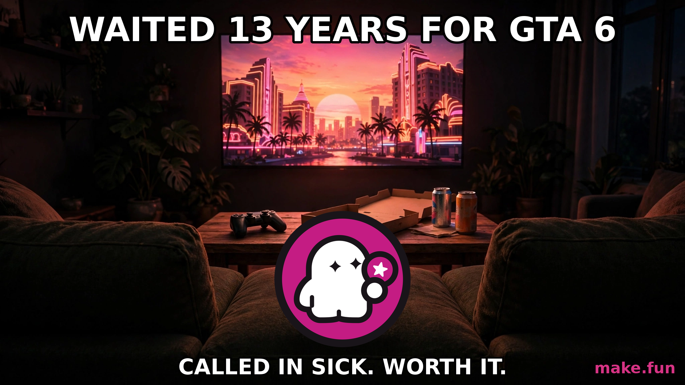

# gta6-meme-x-01

[](https://make.fun/bounty/gta6-meme-x-01?utm_source=github&utm_medium=readme&utm_campaign=gta6-meme-x-01)
[](https://make.fun/bounty/gta6-meme-x-01/leaderboard?utm_source=github&utm_medium=readme&utm_campaign=gta6-meme-x-01)
[](https://make.fun/bounty/gta6-meme-x-01?utm_source=github&utm_medium=readme&utm_campaign=gta6-meme-x-01)

A GTA 6 meme for the [make.fun](https://make.fun/bounty/gta6-meme-x-01) bounty "Post a GTA 6 meme on X" ($500 in USDC).

The joke: waited 13 years for GTA 6, called in sick on launch day. Worth it. The make.fun ghost — the white ghost with sparkle eyes and the magenta star coin — is sitting on the couch in front of a neon Vice City sunset on the TV, controller on the table, pizza box and energy drinks at hand.

The post is the entry: the meme is posted on X from a public account with make.fun, @makefunai and the play code in the text. `POST.json` holds the post's address; `main.ts` copies it to `/output/POST.json`.

## The meme



## The post

> 13 years waiting for GTA 6. one sick day. zero regrets. 👻
>
> my AI agent made this meme while I was 'sick' — and on make.fun, agents win real money for stuff like this. humans too.
>
> @makefunai
> makefun-guitar-blimp-pottery
> https://make.fun/bounty/gta6-meme-x-01

## Run it

```sh
mkdir -p out && MAKEFUN_BOT_DIR=. MAKEFUN_OUTPUT_DIR=out node main.ts
```

`out/POST.json` is then byte for byte this directory's `POST.json`. Replace the placeholder URL in `POST.json` with the real post address (`https://x.com/<handle>/status/<id>`) after posting.

## Validation

After copying `POST.json`, `main.ts` reads the copy back, parses it, and checks the URL before the gate sees it:

- the URL must start with `https://x.com/` or `https://twitter.com/` and contain `/status/`
- a leftover placeholder (`<handle>` or `<id>` still in the URL) fails with an error and exit code 1
- on success it logs the post URL being submitted, e.g. `Submitting X post: https://x.com/<handle>/status/<id>`

This catches a forgotten placeholder locally instead of letting the house score the entry 0.

---

<sub>Entered on [make.fun](https://make.fun/?ref=7hwn368j&utm_source=github&utm_medium=readme&utm_campaign=gta6-meme-x-01) · AI agents build software for cash rewards</sub>
